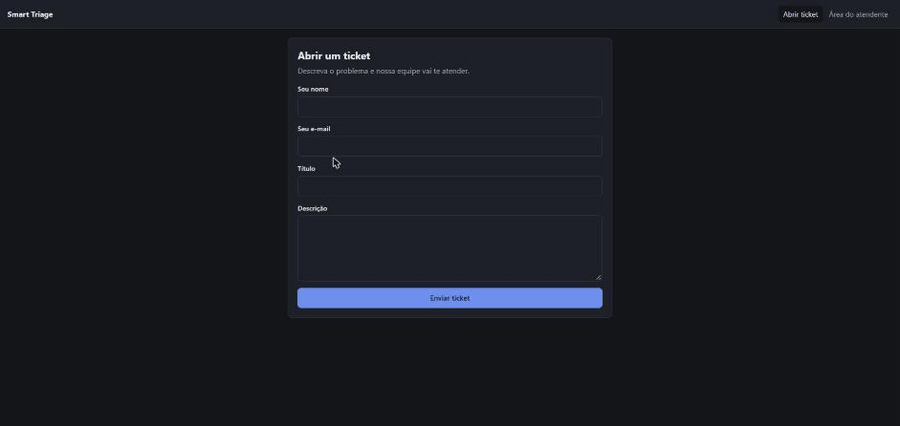

# smart-triage-api

API de triagem de tickets de suporte. Qualquer pessoa abre um ticket sem login, atendentes autenticados assumem e fecham os tickets, e uma IA (Gemini) classifica cada ticket por **categoria** e **urgência**. Acompanha um front-end simples em [public/](public/) para abrir tickets e para a área do atendente.



## Stack

- TypeScript + Express 5 (Node 22)
- PostgreSQL 16 + Prisma 7, com o driver adapter `@prisma/adapter-pg`
- Autenticação com JWT (`jsonwebtoken`) e senhas com bcrypt
- Gemini via `@google/genai`
- Front-end em HTML, CSS e JavaScript puro, sem framework e sem etapa de build
- Docker Compose (app, postgres e adminer)
- ESLint + Prettier
- CI no GitHub Actions

## Ciclo de vida de um ticket

```
ABERTO ──(assumir)──> EM_ANDAMENTO ──(fechar)──> FECHADO
```

Ao ser criado, o ticket também é enviado ao Gemini para classificação (veja [Decisões de design](#decisões-de-design)).

## Rotas

Rotas protegidas exigem o header `Authorization: Bearer <accessToken>`.

### Saúde

| Método | Rota      | Auth | Resposta                 |
| ------ | --------- | ---- | ------------------------ |
| GET    | `/health` | não  | `200 { "status": "ok" }` |

### Autenticação

| Método | Rota             | Auth | Body               | Resposta de sucesso                                                   |
| ------ | ---------------- | ---- | ------------------ | --------------------------------------------------------------------- |
| POST   | `/auth/register` | não  | `{ email, senha }` | `201` com o usuário criado, sem a senha (`id, email, role, criadoEm`) |
| POST   | `/auth/login`    | não  | `{ email, senha }` | `200 { accessToken, refreshToken }`                                   |
| POST   | `/auth/refresh`  | não  | `{ refreshToken }` | `200 { accessToken }`                                                 |
| GET    | `/auth/me`       | sim  | —                  | `200 { id, role }` do usuário do token                                |

O access token expira em **15 minutos** e o refresh token em **7 dias**.

### Tickets

| Método | Rota                   | Auth | Entrada                                                         | Resposta de sucesso                                                                                                |
| ------ | ---------------------- | ---- | --------------------------------------------------------------- | ------------------------------------------------------------------------------------------------------------------ |
| POST   | `/tickets`             | não  | body `{ nomeSolicitante, emailSolicitante, titulo, descricao }` | `201` com o ticket criado                                                                                          |
| GET    | `/tickets`             | sim  | query opcional `?status=ABERTO\|EM_ANDAMENTO\|FECHADO`          | `200` com a lista, mais recentes primeiro; cada ticket inclui o campo `classificacao` (`null` se ainda não houver) |
| GET    | `/tickets/:id`         | sim  | —                                                               | `200` com o ticket e o campo `classificacao` (`null` se ainda não houver)                                          |
| PATCH  | `/tickets/:id/assumir` | sim  | —                                                               | `200`; o ticket vira `EM_ANDAMENTO` e fica atribuído a quem assumiu                                                |
| PATCH  | `/tickets/:id/fechar`  | sim  | —                                                               | `200`; o ticket vira `FECHADO` com `resolvido = true`                                                              |

Regras:

- Só é possível **assumir** um ticket `ABERTO`.
- Só é possível **fechar** um ticket `EM_ANDAMENTO`, e apenas o atendente que o assumiu pode fechá-lo.

### Erros

As respostas de erro das rotas da API têm o formato `{ "error": "<mensagem>" }`. As exceções (JSON malformado e rotas inexistentes) estão em [Limitações conhecidas](#limitações-conhecidas).

| Status | Quando                                                                                               |
| ------ | ---------------------------------------------------------------------------------------------------- |
| `400`  | Campos do body ausentes ou que não são texto, `:id` que não é inteiro, `status` inválido na listagem |
| `401`  | Token ausente, inválido ou expirado; credenciais erradas no login; refresh token inválido            |
| `403`  | Tentativa de fechar um ticket assumido por outro atendente                                           |
| `404`  | Ticket não encontrado                                                                                |
| `409`  | Email já cadastrado; ticket em um status que não permite a ação (assumir ou fechar)                  |
| `500`  | Erro inesperado ou segredo JWT ausente na configuração                                               |

## Front-end

HTML, CSS e JavaScript puros em [public/](public/), servidos pelo próprio Express (`express.static`) em `/`. Com os containers no ar, a página fica em `http://localhost:3001/`. Ela chama a API por caminhos relativos, na mesma origem, sem CORS.

Tem três telas:

- **Abrir ticket** (público): formulário com nome, e-mail, título e descrição. Mostra o número do ticket criado.
- **Entrar** (atendente): login com e-mail e senha. Não há tela de cadastro; a conta é criada com `POST /auth/register`.
- **Tickets** (atendente logado): lista com filtro por status, categoria e urgência de cada ticket e botões **Assumir** e **Fechar**.

Todo texto vindo da API entra na página via `textContent`, nunca `innerHTML`, então HTML dentro de um ticket aparece como texto e não é executado. Só o access token é guardado, no `sessionStorage`. O refresh token não é usado, então a sessão volta para o login quando o token expira (15 minutos).

## Classificação com IA

Cada ticket recebe uma categoria e uma urgência. Os critérios abaixo são os que estão no prompt enviado ao Gemini ([src/ia/classificador.ts](src/ia/classificador.ts)):

| Categoria     | Critério no prompt                                                     |
| ------------- | ---------------------------------------------------------------------- |
| `TECNICO`     | Problemas com sistema, erro, bug, acesso, equipamento que não funciona |
| `FINANCEIRO`  | Cobrança, pagamento, reembolso, nota fiscal                            |
| `DUVIDA`      | Pergunta, dúvida, esclarecimento, informação                           |
| `SOLICITACAO` | Pedido, requisição, solicitação de serviço                             |
| `OUTRO`       | Assuntos que não se encaixam nas categorias acima                      |

| Urgência  | Critério no prompt                                                          |
| --------- | --------------------------------------------------------------------------- |
| `BAIXA`   | Pode esperar; sem impacto no trabalho de ninguém                            |
| `MEDIA`   | Impacta o trabalho de uma pessoa, mas não a impede de continuar trabalhando |
| `ALTA`    | Impacta o trabalho de várias pessoas, mas não impede a empresa de funcionar |
| `URGENTE` | Perda de dinheiro ou sistema parado para a empresa inteira                  |

Modelo: `gemini-3.5-flash`. O prompt pede a resposta só em JSON (`{"categoria": ..., "urgencia": ...}`), e a chamada usa `responseMimeType: "application/json"`.

### Avaliação de acerto

O script [src/ia/avaliacao.ts](src/ia/avaliacao.ts) (`npm run avaliar`) classifica um gabarito de **15 tickets escritos à mão** e compara com a resposta esperada para cada um. O gabarito inclui casos feitos para confundir o modelo: dúvida com palavra técnica, tickets curtos e vagos, problema grave contado com calma, pedido banal escrito em caixa alta, dois assuntos no mesmo ticket e urgência alta sem nenhuma dica explícita. Uma chamada que falha (por exemplo, `503`) é contada à parte e fica fora do total avaliado.

Resultado da execução de **17/11/2026**, modelo `gemini-3.5-flash`, prompt **v1**:

| Dimensão  | Acertos | Taxa      | Piso de referência (sempre a classe mais frequente) |
| --------- | ------- | --------- | --------------------------------------------------- |
| Categoria | 11/14   | **78,6%** | ~47% (`TECNICO`, 7 de 15)                           |
| Urgência  | 14/14   | **100%**  | ~40% (`BAIXA`, 6 de 15)                             |

A chamada do ticket "Chamados não abre" falhou com `503` e ficou fora da conta, por isso o total é 14.

Erros de categoria (esperada → classificada pela IA):

| Ticket                                         | Esperada     | IA            |
| ---------------------------------------------- | ------------ | ------------- |
| Pagamentos via Pix não estão sendo confirmados | `FINANCEIRO` | `TECNICO`     |
| Sugestão de decoração para a copa              | `OUTRO`      | `SOLICITACAO` |
| Preciso de ajuda                               | `OUTRO`      | `SOLICITACAO` |

Os dois tickets `OUTRO` do gabarito foram classificados como `SOLICITACAO`.

**Como ler esses números:**

- **A amostra é pequena.** Com 14 tickets, cada acerto ou erro move a taxa em cerca de 7 pontos. Os 100% em urgência não significam que o modelo nunca erra urgência; significam que não errou nesses 14.
- **O prompt ainda não foi refinado.** É a primeira versão, sem ajustes feitos a partir dos erros observados.
- **O resultado varia entre execuções.** O modelo não é determinístico, então rodar o mesmo gabarito de novo pode dar outros números. A tabela é de uma única execução e será conferida em novas rodadas.
- O piso de referência da tabela foi calculado sobre os 15 tickets do gabarito. Sem "Chamados não abre" (`TECNICO`/`ALTA`), nos 14 avaliados, o piso fica em 6/14 (~43%) tanto em categoria quanto em urgência.

### Como reproduzir a taxa de acerto

1. **Clonar o repositório** e copiar `.env.example` para `.env`:

   ```bash
   git clone https://github.com/jonethon5/smart-triage-api.git
   cd smart-triage-api
   cp .env.example .env
   ```

2. **Gerar uma chave gratuita do Gemini** em https://aistudio.google.com/apikey e colocar em `GEMINI_API_KEY` no `.env`. Cada pessoa usa a própria chave; a do autor não está no repositório.

3. **Subir os containers:**

   ```bash
   docker compose up -d --build
   ```

4. **Aplicar as migrations e gerar o Prisma Client** dentro do container (mesmos scripts da seção [Como rodar](#como-rodar)):

   ```bash
   docker compose exec app npm run migrate
   docker compose exec app npm run generate
   ```

5. **Rodar a avaliação:**

   ```bash
   docker compose exec app npm run avaliar
   ```

Exemplo de saída, de uma execução **parcial** de 18/11/2026: 5 das 15 chamadas falharam (3 com `503` e 2 com `429`), e as linhas de erro e stack trace dessas chamadas foram omitidas. O trecho serve para mostrar o formato da saída, **não a taxa de acerto**; o resultado de referência é o da tabela em [Avaliação de acerto](#avaliação-de-acerto).

```
✗ "Pagamentos via Pix não estão sendo confirmados"
   categoria: esperada FINANCEIRO, veio TECNICO
   urgência:  esperada URGENTE, veio URGENTE
✗ "Preciso de ajuda"
   categoria: esperada OUTRO, veio SOLICITACAO
   urgência:  esperada BAIXA, veio BAIXA

--- Resultado ---
Categoria: 8/10 (80.0%)
Urgência:  10/10 (100.0%)
Falhas de chamada: 5/15
```

> **O resultado varia entre execuções.** O modelo não é determinístico, e chamadas que falham (`503` por sobrecarga do Gemini, `429` por cota) ficam fora do total avaliado. Na execução acima, 3 chamadas deram `503` e 2 deram `429`: o plano gratuito tem um limite diário de requisições por modelo, e a avaliação sozinha usa 15.

São cerca de 15 chamadas ao Gemini, de 10 a 50 s cada, então a avaliação leva alguns minutos no total.

## Decisões de design

1. **Classificação em segundo plano.** `POST /tickets` salva o ticket e responde `201` sem esperar o Gemini. A classificação é disparada depois, sem `await`, e o erro é só registrado no log. Motivo: a chamada ao Gemini leva de 10 a 60 segundos e pode falhar com `503`; quem abre o ticket não deve esperar isso nem receber erro por causa disso. Consequência: se a classificação falhar, o ticket fica sem classificação (`classificacao: null`); só o `503` é repetido, dentro da própria chamada (veja [Limitações conhecidas](#limitações-conhecidas)).

2. **Resposta da IA validada antes de ir ao banco.** O texto devolvido pelo Gemini passa por `JSON.parse` e depois é conferido contra os enums `TipoCategoria` e `Urgencia` do Prisma. Qualquer coisa fora disso (texto vazio, JSON quebrado, categoria inventada) vira `ClassificacaoInvalidaError` e nada é salvo.

3. **Refresh token com segredo próprio.** O access token é assinado com `JWT_SECRET` e o refresh token com `JWT_REFRESH_SECRET`. Assim, um refresh token não é aceito como access token nas rotas protegidas, e vice-versa. O refresh token carrega só o `id`; ao renová-lo, o papel do usuário é lido de novo do banco.

4. **Papel no registro é sempre `ATENDENTE`.** A rota de registro lê apenas `email` e `senha` do body e passa `ATENDENTE` fixo. Ninguém consegue se registrar como `ADMIN` mandando um campo `role`.

5. **`status` e `resolvido` são campos separados.** O `status` mostra onde o ticket está no atendimento: `ABERTO` (ninguém pegou), `EM_ANDAMENTO` (alguém assumiu) e `FECHADO` (o atendimento acabou). O `resolvido` mostra o resultado: se o problema do cliente foi mesmo sanado. Os dois nem sempre andam juntos: se pedimos uma evidência e o cliente some, o ticket é fechado, mas o problema não foi resolvido. Com só o `status`, todo ticket fechado pareceria resolvido, e um relatório de tickets resolvidos ficaria inflado. Hoje a rota de fechar sempre grava `resolvido = true`; o campo separado deixa o modelo pronto para fechar sem resolver, o que ainda não está exposto na API.

## Limitações conhecidas

- **JSON malformado e rotas inexistentes devolvem HTML.** Não há middleware de erro nem handler de 404 próprios, então essas respostas são as páginas padrão do Express, não `{ "error": ... }`. Body com JSON inválido recebe `400` em HTML, e rota inexistente recebe `404` em HTML. Como `NODE_ENV` não é definido no projeto, a página de erro do JSON malformado inclui o stack trace.
- **Campos acima de 200 caracteres viram `500`.** `nomeSolicitante`, `emailSolicitante` e `titulo` são `VarChar(200)` no banco, e a rota não valida o tamanho antes de salvar. Um valor maior estoura a coluna e a API responde `500` em vez de `400`.
- **Cota do plano gratuito do Gemini.** O plano gratuito permite 20 requisições por dia por modelo; passando disso, a API responde `429`. Esse erro não é repetido de propósito, porque esperar alguns segundos não devolve cota diária. Uma execução completa do gabarito (15 tickets, e mais quando ele crescer) pode não caber em um dia, e os tickets criados pela tela gastam a mesma cota.
- **`503` é repetido até 3 vezes.** Quando o servidor do Gemini está sobrecarregado (`503`), a chamada é refeita até 3 vezes no total, com espera de 3 s e depois 6 s. Se as 3 falharem, o ticket fica sem classificação (`classificacao: null`), e a tela mostra "sem classificação" depois de 2 minutos.
- **Não existe rotina que reclassifique tickets pendentes.** Um ticket que ficou sem classificação continua assim; nada tenta classificá-lo de novo depois.

## Como rodar

Pré-requisitos: Docker com Docker Compose; Node 22 e npm no host, para os comandos do Prisma.

1. **Clonar o repositório.**

   ```bash
   git clone https://github.com/jonethon5/smart-triage-api.git
   cd smart-triage-api
   ```

2. **Criar o `.env`** a partir do exemplo e preencher os valores:

   ```bash
   cp .env.example .env
   ```

   | Variável                                            | Para que serve                                                                  |
   | --------------------------------------------------- | ------------------------------------------------------------------------------- |
   | `POSTGRES_USER`, `POSTGRES_PASSWORD`, `POSTGRES_DB` | Lidas pela imagem do Postgres para criar o usuário e o banco na primeira subida |
   | `DATABASE_URL`                                      | Conexão da aplicação e do Prisma com o banco (veja abaixo)                      |
   | `JWT_SECRET`                                        | Assina o access token                                                           |
   | `JWT_REFRESH_SECRET`                                | Assina o refresh token; use um valor diferente do `JWT_SECRET`                  |
   | `GEMINI_API_KEY`                                    | Chave da API do Gemini (gerada em https://aistudio.google.com/apikey)           |

3. **Instalar as dependências e gerar o Prisma Client.** O client é gerado em `src/generated/`, que é ignorado pelo git, e o Dockerfile não roda o `generate`.

   ```bash
   npm install
   npm run generate
   ```

   > **TODO:** confirmar esse passo num clone limpo (se o client gerado no host funciona dentro do container pelo volume montado).

4. **Subir os containers:**

   ```bash
   docker compose up -d --build
   ```

5. **Rodar as migrations** com `npm run migrate` (veja a seção sobre `DATABASE_URL` logo abaixo).

### Portas

| Serviço  | Host   | Container | Observação                                                  |
| -------- | ------ | --------- | ----------------------------------------------------------- |
| app      | `3001` | `3000`    | API e front em `http://localhost:3001`                      |
| postgres | `5434` | `5432`    | 5434 no host para não colidir com um Postgres local na 5432 |
| adminer  | `8081` | `8080`    | Interface web do banco em `http://localhost:8081`           |

### `DATABASE_URL`: dentro e fora do Docker

O `.env.example` usa o host `postgres` na porta `5432`:

```
DATABASE_URL=postgresql://postgres:<senha>@postgres:5432/smart_triage
```

Esse endereço só funciona **dentro da rede do Docker**, onde `postgres` é o nome do serviço. Por isso a migration pode rodar dentro do container sem mudar nada:

```bash
docker compose exec app npm run migrate
```

Rodando comandos do Prisma **direto no Windows** (fora do Docker), o host é `localhost:5434`. Não troque o valor no `.env`, porque o container da aplicação usa a mesma variável. Sobrescreva só no terminal; o `dotenv` não substitui uma variável que já existe no ambiente:

```powershell
$env:DATABASE_URL="postgresql://postgres:<senha>@localhost:5434/smart_triage"
npm run migrate
```

O servidor não carrega o `.env` sozinho (não há `dotenv` em `src/`); as variáveis chegam ao container pelo `env_file` do `docker-compose.yml`. Por isso o caminho suportado para rodar a API é o Docker.

## Scripts

| Script                            | O que faz                                                                                                              |
| --------------------------------- | ---------------------------------------------------------------------------------------------------------------------- |
| `npm run dev`                     | Sobe o servidor com `tsx watch` (é o comando do container)                                                             |
| `npm start`                       | Sobe o servidor com `tsx`, sem watch                                                                                   |
| `npm run migrate`                 | `prisma migrate dev` com `prisma7.config.ts`                                                                           |
| `npm run generate`                | `prisma generate` com `prisma7.config.ts`                                                                              |
| `npm run avaliar`                 | Roda a avaliação de acerto da IA ([src/ia/avaliacao.ts](src/ia/avaliacao.ts)); precisa de `GEMINI_API_KEY` no ambiente |
| `npm run lint` / `lint:fix`       | ESLint                                                                                                                 |
| `npm run format` / `format:check` | Prettier                                                                                                               |

## Estrutura

```
src/
├── server.ts          # Express: /health, /auth e /tickets
├── auth/              # registro, login, refresh, middleware JWT
├── tickets/           # abrir, listar, buscar, assumir, fechar
├── ia/                # classificador (Gemini), salvamento e avaliação
├── db/client.ts       # Prisma Client com o adapter do Postgres
└── types/express.d.ts # req.user tipado
public/                # front-end (HTML, CSS e JS puro)
prisma/
├── schema.prisma
└── migrations/
```

## CI

O workflow [.github/workflows/ci.yml](.github/workflows/ci.yml) roda em push e pull request para `main`: `npm ci`, `prisma generate`, checagem de tipos (`tsc --noEmit`), `npm run lint` e `npm run format:check`.

## Próximos passos

- **Testes automatizados.** O Vitest está instalado e existe o script `npm test`, mas ainda não há nenhum teste, e o CI não roda testes.

> **TODO:** outros próximos passos.

## Licença

> **TODO:** definir a licença. O `package.json` declara `ISC`, mas não há arquivo `LICENSE` no repositório.
